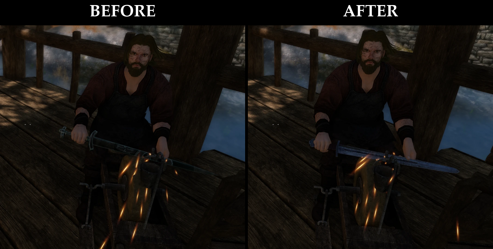

# Grindstone Sword Fix

SKSE plugin for Skyrim Special Edition / Anniversary Edition. The sword on the
grindstone matches the Iron Sword you have installed.

## The problem

When an NPC (or the player, without a crafting-animation mod) uses a
grindstone, the game loads a fixed "anim object" (`AnimObjectIronSword`,
`Skyrim.esm` 0x10FD00) with its own copy of the vanilla iron sword mesh.
Weapon replacers change the iron sword textures, which then no longer fit
that old mesh.

## What the plugin does

1. At data load it points `AnimObjectIronSword` at the model of the winning
   `Iron Sword` record (`Skyrim.esm` 0x12EB7). Works with any replacer, mesh
   or record based, no configuration.
2. A hook on the anim object loader (`AnimationObjects::Load`) fixes the
   loaded weapon mesh: hides the scabbard node (`Scb`) and, if the mesh was
   attached to the sheath (`Prn=WeaponSword`), moves it to the right hand
   (`AnimObjectR`). Other anim objects are never touched.

Mods that replace the player's crafting animations (e.g. Dynamic Crafting
Animations) keep working; those animations don't load this anim object.

## Requirements

- SKSE64 and Address Library for SKSE Plugins, matching the exact Skyrim runtime
  and store.
- Runtimes: Steam 1.5.97, 1.6.317, 1.6.318, 1.6.323, 1.6.342, 1.6.353, 1.6.629,
  1.6.640, 1.6.1130, 1.6.1170, 1.7.99, 1.7.104; GOG 1.6.659 and 1.6.1179. No VR.

## Installation

Install `Grindstone Sword Fix.zip` with a mod manager. No plugin slot, no
configuration. Log: `Documents/My Games/Skyrim Special Edition/SKSE/GrindstoneSwordFix.log`.

## Building

See [docs/BUILD.md](docs/BUILD.md). The version is set only in `CMakeLists.txt`.

## Repository layout

| Location | Contents |
|---|---|
| `src/`, `include/GrindstoneSwordFix/` | Plugin source |
| `tests/` | Engine-independent unit tests (run by `ctest`) |
| `tools/` | Packaging and validation scripts |
| `dist/Data/` | Staged game files (the DLL) |
| `docs/` | Build instructions and images |

## License

Copyright (C) 2026 victormmarcos

This program is free software: you can redistribute it and/or modify it
under the terms of the GNU General Public License as published by the Free
Software Foundation, either version 3 of the License, or (at your option)
any later version.

This program is distributed in the hope that it will be useful, but WITHOUT
ANY WARRANTY; without even the implied warranty of MERCHANTABILITY or FITNESS
FOR A PARTICULAR PURPOSE. See the GNU General Public License for more details.

The full license text is in [LICENSE.txt](LICENSE.txt), also available at
<https://www.gnu.org/licenses/gpl-3.0.txt>. Third-party components are listed
in [THIRD_PARTY_NOTICES.md](THIRD_PARTY_NOTICES.md).

## Credits

- CommonLibSSE-NG (GPL-3.0).
- powerofthree, for finding the `AnimationObjects::Load` call site
  (AnimObject Swapper). No code from that project is used.
